<div align="center">


<br>

**A local-first control plane for durable, verified, AI-assisted software engineering.**

Claude Code, Codex, OpenCode, Gemini — they are *replaceable executors*. The core is provider-neutral;
the Claude adapter is the only real provider adapter today.<br>
Runlith is the layer above them that remembers, plans, isolates, verifies, and recovers.

<br>

[](LICENSE)
[](Cargo.toml)
[](#-status--roadmap)
[](#-principles)

[Why](#-why-runlith) ·
[Quick start](#-quick-start) ·
[How it works](#-how-it-works) ·
[Mechanics](#-mechanics-in-depth) ·
[Roadmap](#-status--roadmap) ·
[Contributing](#-contributing)

</div>

<br>

> [!WARNING]
> Runlith is **pre-release** (`0.1.0`, currently gate **G13**). There is no public release yet, interfaces
> may change, and only `main` is supported. Great time to read the code and shape the direction — not yet
> a time to depend on it in production.

---

## ✦ Why Runlith

AI coding agents are powerful and **forgetful**. A session ends, a context window fills up, a provider hits its
quota, a process crashes — and the work evaporates into a chat transcript.

Runlith treats that as an infrastructure problem, not a prompting problem.

```text
 Without Runlith                          With Runlith
 ───────────────                          ────────────
 chat session = project state             Task graph = project state (SQLite + append-only journal)
 agent says "done"  → you hope            evidence says "verified" → you know
 context full       → start over          checkpoints + epochs → continue, even on another provider
 prompt says "be careful"                 policy + OS isolation enforce it
 one provider, one session                provider-neutral core, swappable executors
```

> **What can Runlith do more reliably, continuously, or efficiently than using coding-agent products separately?**
> That question gates every feature. If a capability can be reproduced by opening another agent terminal, it
> does not belong here. See the [Project Charter](PROJECT_CHARTER.md).

## ✦ Highlights

<table>
<tr>
<td width="50%" valign="top">

### 🗂 Durable tasks
Tasks persist across restarts, crashes, model switches, and handoffs. `Task ≠ Execution ≠ Attempt ≠ Session`
— the Task is the durable entity, everything else is replaceable.

</td>
<td width="50%" valign="top">

### ✅ Verified delivery
An agent never declares *done*. Only the independent evaluation pipeline can grant completion, from tests,
review, and acceptance evidence — never from model self-report.

</td>
</tr>
<tr>
<td valign="top">

### 🛡 Agent Firewall
Policy returns `ALLOW` / `DENY` / `REQUIRE_APPROVAL` *before* execution. Runners enforce filesystem, network,
and process limits (macOS Seatbelt today) and **fail closed** when enforcement is missing.

</td>
<td valign="top">

### 🔑 Secrets that never leak
Credentials live only in the OS keychain or an encrypted vault. Plaintext never enters model context, logs,
events, or SQLite.

</td>
</tr>
<tr>
<td valign="top">

### 🌿 Isolated workspaces
Every execution gets its own Git worktree and branch. Agents never touch your working copy, and diffs are
explicit artifacts.

</td>
<td valign="top">

### ♾ Context continuity
Provider-independent epochs and checkpoints (*no checkpoint → no rollover*) let a task outlive any single
context window — or any single provider.

</td>
</tr>
<tr>
<td valign="top">

### 🧭 Bounded adaptive planning
Planners *propose*, validated services *decide*. Nine validation rules and hard numeric guardrails stop
runaway decomposition; risky changes need a human.

</td>
<td valign="top">

### 🧑‍💻 Human in the loop
Approvals, replan/abort decisions, and full **takeover** are first-class durable records — not chat
messages you hope someone sees.

</td>
</tr>
</table>

## ✦ Quick start

**Requirements:** Rust `1.95` (the version CI pins), Git, macOS for the sandboxed runner.

```sh
git clone https://github.com/fallowlone/Runlith.git
cd Runlith

cargo build --locked --bin agentd --bin agentctl
```

Start the local daemon and talk to it through `agentctl`:

```sh
agentctl=./target/debug/agentctl

$agentctl start                       # spawn the sibling agentd daemon
$agentctl ping                        # handshake + version check

$agentctl project create demo "Demo project"
$agentctl task create t1 demo "Add input validation to the signup form"

$agentctl execution run t1 /path/to/your/repo
$agentctl execution status <execution-id>
```

<details>
<summary><b>More commands</b></summary>

```text
agentctl project   create | get | list
agentctl task      create | get | list | dependency add|list
                   ready | claim | start | resume | block | submit | review
                   verify-begin | verify-fail | verify-succeed
agentctl execution run | status | cancel | resume
agentctl approval  get | decide <approve|deny>
agentctl human-decision list | get | decide <resume|replan|abort|takeover>
agentctl planning  trigger | apply
agentctl find      query | show        # evidence search over a repository
agentctl vault     …                   # secret references and bindings
```

There is intentionally **no** `set-state` and no `done` shortcut: lifecycle commands stay semantic, and
completion is earned through verification.

</details>

<details>
<summary><b>macOS: linking fails with <code>cc</code> exit 69?</b></summary>

Point the toolchain at the Command Line Tools:

```sh
export DEVELOPER_DIR=/Library/Developer/CommandLineTools
```

</details>

<details>
<summary><b>Using a real provider</b></summary>

The Claude adapter drives the authenticated `claude` CLI. Live smoke tests are `#[ignore]`d and need
`RUNLITH_CLAUDE_SMOKE=1`. Deterministic fixture tests do not prove live-provider support. See
[`docs/architecture/providers.md`](docs/architecture/providers.md).

</details>

---

## ✦ How it works

The big picture: **the agent is one box in the middle.** Everything around it — state, scheduling, authority,
verification — is owned by Runlith and survives the agent.

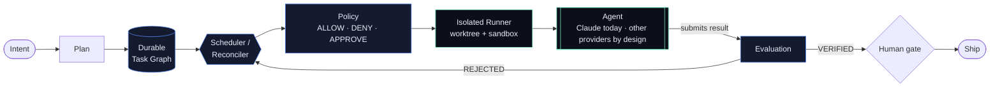

### System map

Runlith is a **local Rust modular monolith** with **Ports & Adapters**. Domains own behaviour, adapters own I/O,
and concrete adapters are assembled *only* in the composition root (`agentd`) — no domain crate instantiates
infrastructure. A port belongs to its **consumer**, never to the infrastructure that implements it.

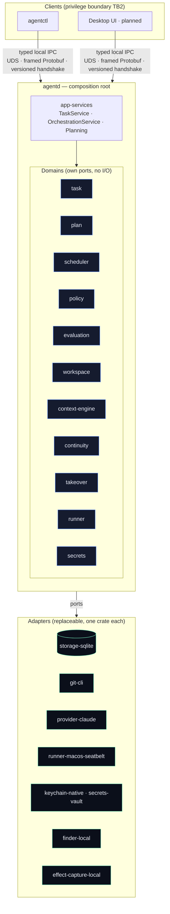

| Layer | Packages | Role |
|---|---|---|
| **Binaries** | `agentd`, `agentctl` | Daemon composition root and the CLI client |
| **Domains & services** | `task`, `plan`, `scheduler`, `policy`, `evaluation`, `workspace`, `app-services`, … | Business rules; own ports, never infrastructure |
| **Contracts** | `ipc-contracts`, `execution-contract`, `planner-contract`, `secret-backend-contract`, … | Reusable contract suites any adapter must pass |
| **Adapters** | `storage-sqlite`, `git-cli`, `provider-claude`, `runner-macos-seatbelt`, `keychain-native`, `secrets-vault`, … | Concrete I/O, one replaceable crate each |

**48 packages** in one Cargo workspace (34 shared crates, 12 adapters, 2 binaries). A second provider must slot in
*without core changes* — that is the test of the design.

### One run, end to end

What actually happens when you type `agentctl execution run`:

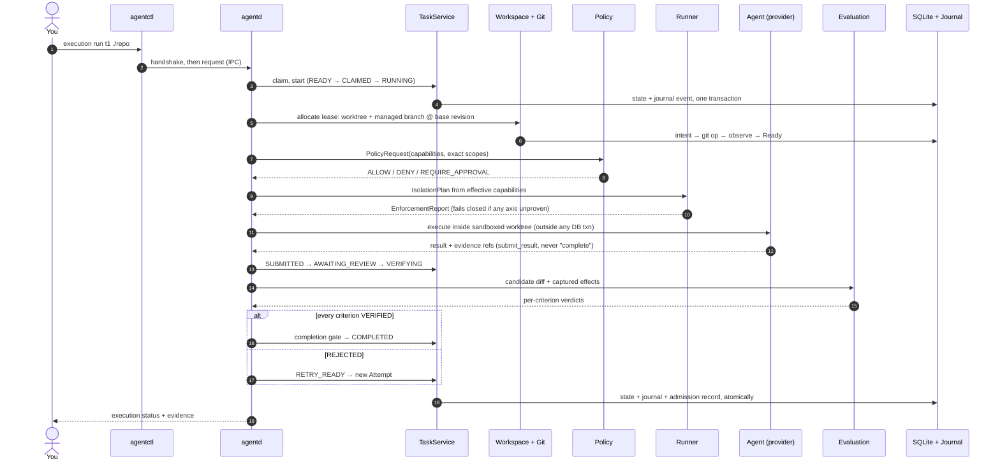

---

## ✦ Mechanics in depth

Each section below is a contract that the code enforces. Deep links point to the source documents.

- [Task lifecycle](#-task-lifecycle) · [Task ≠ Execution ≠ Attempt ≠ Session](#-the-four-concepts)
- [Policy & approvals](#-policy--approvals) · [Isolation (runners)](#-isolation-runners)
- [Workspaces & Git](#-workspaces--git) · [Verified completion](#-verified-completion)
- [Adaptive planning](#-adaptive-planning) · [Human decisions & takeover](#-human-decisions--takeover)
- [Context engine](#-context-engine) · [Continuity & rollover](#-continuity--rollover)
- [Persistence](#-persistence-three-ledgers) · [IPC](#-ipc-handshake) · [Secrets](#-secrets)

### 🔁 Task lifecycle

Twelve fixed states. State names are never renamed, added, or reordered; every transition has a defined authority.

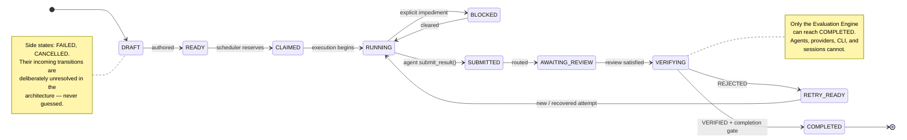

| Rule | Meaning |
|---|---|
| **Submission is a claim** | The agent runtime API is `submit_result()` — there is no `complete_task()`. |
| **`READY` ≠ runnable** | *Scheduling readiness* (`RUNNABLE`, `WAITING_ON_DEPENDENCY`, …) is derived, never persisted, never merged into the lifecycle. |
| **Dependencies don't rewrite state** | An unfinished dependency yields `WAITING_ON_DEPENDENCY`; the Task row stays `READY`. |
| **Invalid transitions are refused** | Never silently coerced, never mutate durable state, always observable and testable. |
| **Attempt failure ≠ Task failure** | Provider A can fail; provider B may still finish the same Task. |

### 🧬 The four concepts

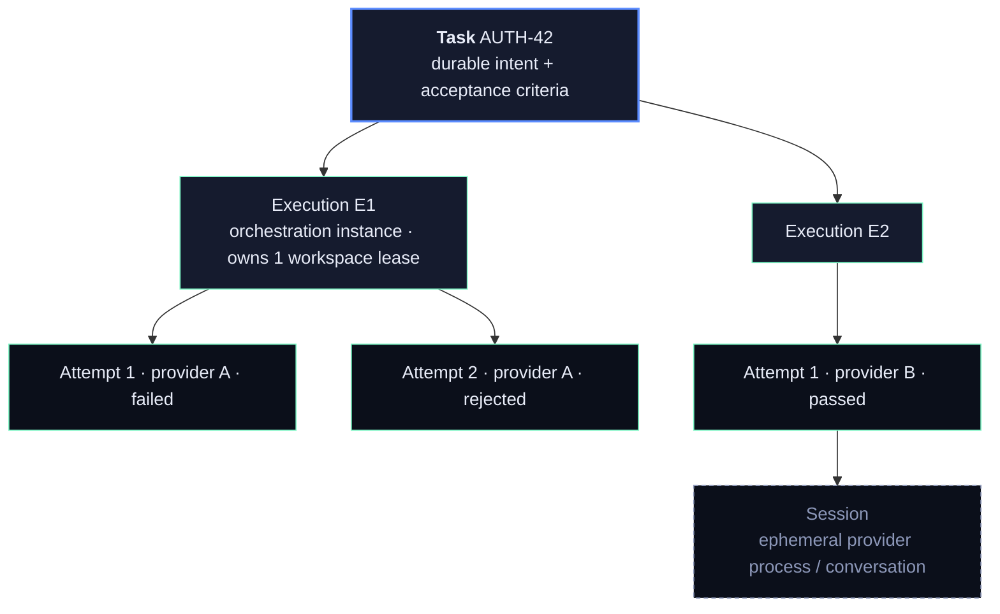

Provider details travel only as opaque references. A field like `claude_session_id` on a Task is an explicit
domain-model violation.

### 🛡 Policy & approvals

Policy is the **canonical authorization authority**. The model, provider CLI, repository, plugin, and
provider-native permission prompts cannot grant authority. Prompts are not a security boundary.

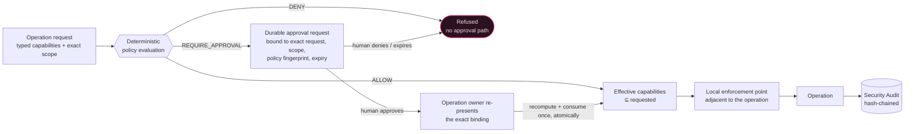

- **Eight capability kinds:** filesystem read · filesystem write · process execute · network access · Git mutate ·
  secret access · tool invoke · external action. Scopes are exact — no wildcards, no free-form expressions.
- **Precedence:** `DENY > REQUIRE_APPROVAL > ALLOW`. A weaker layer can never override a hard deny.
- **`effective ⊆ requested`**, and a child's authority is always `⊆` its parent's. Delegation can only narrow.
- **An approved row is not a bearer token.** It is consumed exactly once, only when the exact binding is
  re-presented; widening the scope, changing the policy fingerprint, or waiting past expiry requires a new approval.
- Unknown capability, malformed scope, or unprovable child scope **fails closed**.

Source: [`docs/security/POLICY_CONTRACT.md`](docs/security/POLICY_CONTRACT.md) ·
[`TRUST_BOUNDARIES.md`](docs/security/TRUST_BOUNDARIES.md) · [`THREAT_MODEL.md`](docs/security/THREAT_MODEL.md)

### 🧱 Isolation (runners)

Policy decides *what is allowed*. The Runner enforces *what can actually be enforced*. **Both layers are
required; neither replaces the other.**

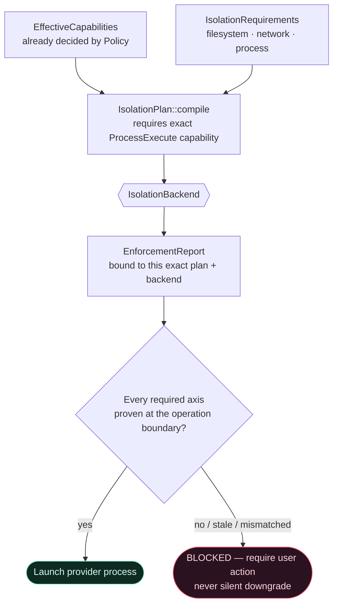

| Backend | Honest claim today |
|---|---|
| `runner-macos-seatbelt` | Confines filesystem, network (outbound TCP/443 only), and process via `sandbox-exec`. Autonomous Claude execution on macOS requires all three axes. |
| `runner-native` | **`Trusted Host`.** Zero enforcement axes. Satisfies only an explicit trusted-host requirement — **not a sandbox**, and never documented as one. |
| Container · Remote · VM | Architectural direction, not implemented. |

On a platform without a concrete backend, the mandatory three-axis requirement makes execution **fail closed
before the provider is launched**. Filesystem isolation is never presented as blocking exfiltration, and process
exit `0` never means the Task is done.

Source: [`docs/architecture/runners.md`](docs/architecture/runners.md)

### 🌿 Workspaces & Git

One Execution owns exactly one `WorkspaceLease`: an isolated worktree on a managed branch, pinned to an immutable
base commit. Agents never write to your checkout or the default branch.

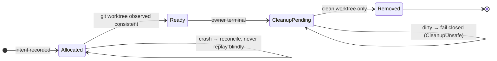

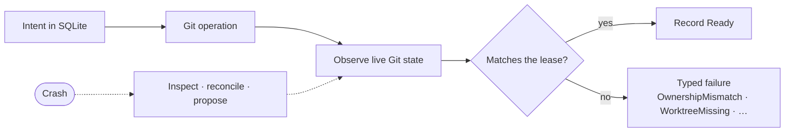

- **SQLite and Git are separate failure domains** — there is no cross-system transaction. The pattern is
  *intent → Git operation → observe → reconcile*, and `Ready` is recorded only after success is observed.
- **Git is the authority for Git facts.** Live observations outrank persisted expectations.
- **Base revision** is an exact commit OID — never `HEAD` or a branch tip. Diffs are computed against it.
- **Dirty work is never silently destroyed.** No invisible `reset --hard`, `clean -fd`, forced removal, or
  `branch -D`. A crash means *inspection*, never *cleanup*.
- The default branch is resolved from repository metadata, not by string-matching `main`/`master`.

Source: [`docs/architecture/workspace.md`](docs/architecture/workspace.md)

### ✅ Verified completion

An agent's claim is **not evidence**. Completion is admitted only through the trusted completion gate, atomically,
and only when every acceptance criterion is independently proven.

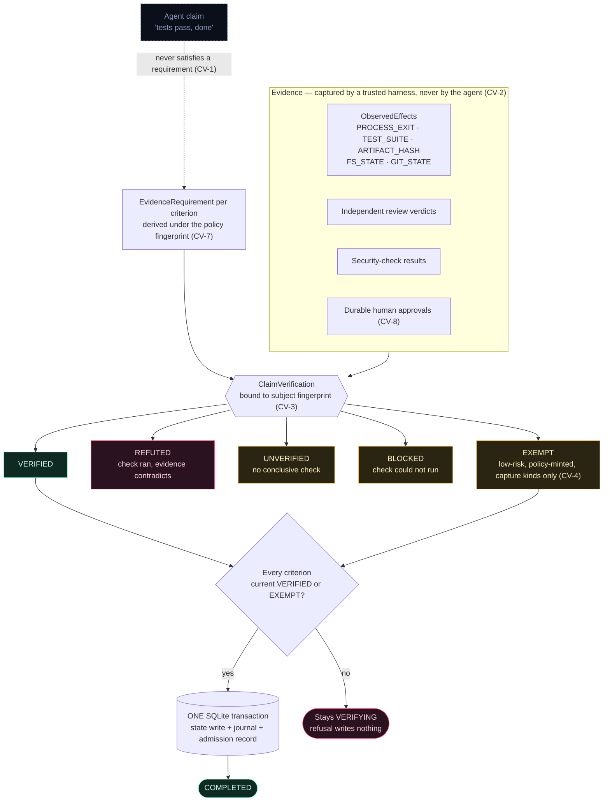

- **A moved subject invalidates evidence.** If the content, config, or toolchain fingerprint changes, the
  criterion goes back to `UNVERIFIED`. Stale evidence is never silently reused.
- **Only `VERIFIED` passes.** `UNVERIFIED`, `BLOCKED`, and `REFUTED` are distinct and none is a pass (CV-6).
- **Supersession, not deletion.** Contradictory verdicts stay durable and queryable via a `superseded_by` chain.
- **Evidence integrity (CV-9):** an agent that edited the tests or checks used to approve its own task cannot
  self-verify.
- A `HUMAN_APPROVAL` requirement survives any automated outcome — automation can never discharge it.

Source: [`ADR-0018`](docs/architecture/adr/ADR-0018-independent-evaluation.md) ·
[`ADR-0030`](docs/architecture/adr/ADR-0030-g8-observed-effect-claim-verification-contract.md)

### 🧭 Adaptive planning

Planners are untrusted proposers. A `PlanChangeSet` becomes durable only after the application service applies
nine rules in order; the first failure refuses the whole proposal and nothing partial persists.

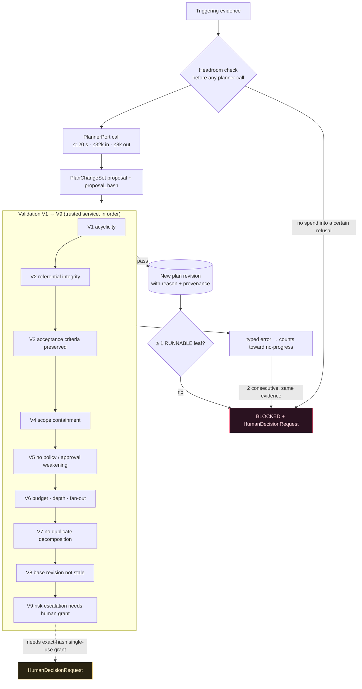

| Guardrail | Value |
|---|---|
| Decomposition depth | ≤ **4** edges |
| Children per decomposition | ≤ **8** |
| Nodes per plan branch | ≤ **64** |
| Accepted revisions per cycle per branch | **1** |
| Planner calls per evidence event per branch | ≤ **8** |
| Cumulative planner input tokens per event | ≤ **256,000** |
| No-progress trip | **2** consecutive rejections |

Creating children **never** satisfies the parent's acceptance — the parent still needs independent verification.
Plan *revisions* and Task *state transitions* are different concepts and never mix. The planner cannot raise its
own limits.

Source: [`ADR-0017`](docs/architecture/adr/ADR-0017-adaptive-planning.md) ·
[`ADR-0027`](docs/architecture/adr/ADR-0027-g7-planning-orchestration-contract.md)

### 🧑‍💻 Human decisions & takeover

When the machine should not continue alone, it opens a durable `HumanDecisionRequest` — it does not guess.

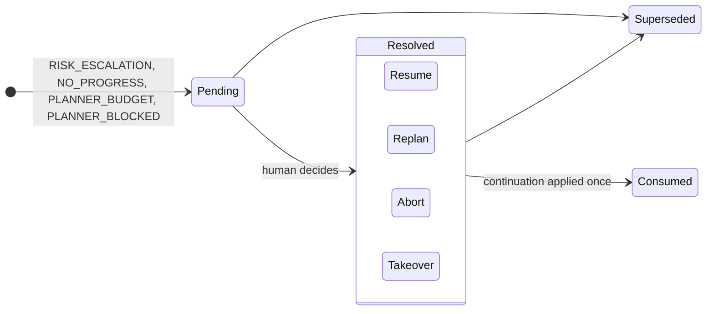

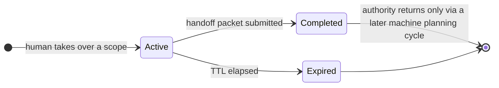

Takeover transfers execution authority to the human for exactly the scoped work. Nothing resumes automatically.

### 🔎 Context engine

The prompt is a **disposable view**, never the system of record. A context package can always be rebuilt from
authoritative sources.

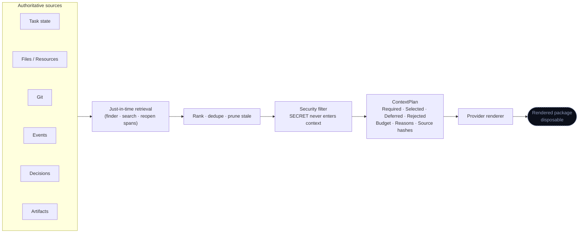

Every `ContextItem` carries its provenance, content hash, freshness, **trust**, **sensitivity**, and cache class —
kept as independent dimensions. High relevance never implies high trust, and retrieved content **never gains
instruction authority**. The plan explains *why* each item is in the window, so selection is observable and
reproducible.

### ♾ Continuity & rollover

The provider's context window is not the task's memory. Work is organised into **epochs** — bounded windows —
with durable checkpoints between them.

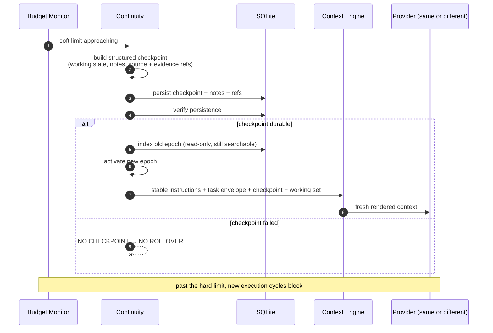

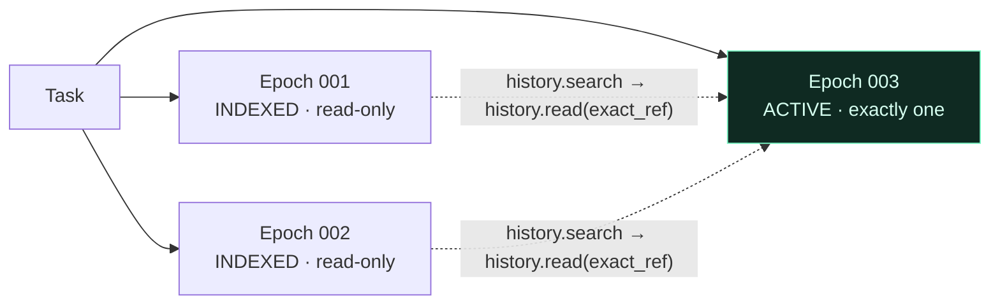

- **No epoch is discarded before a durable checkpoint** — and old evidence stays retrievable after rollover.
- **Raw evidence stays authoritative;** summaries of summaries never become truth.
- **A Task can migrate** between providers by design (for example Claude → another adapter) without losing
  state: a new Attempt, a new Session, a new rendered context — same Task and continuity truth. Claude is the
  only provider adapter implemented today.
- Continuity restores *context and evidence*, never *permission* to blindly replay side effects across providers.

Source: [`docs/architecture/continuity.md`](docs/architecture/continuity.md) ·
[`context-engine.md`](docs/architecture/context-engine.md)

### 🗄 Persistence: three ledgers

Three different questions, three separate stores. They are never merged.

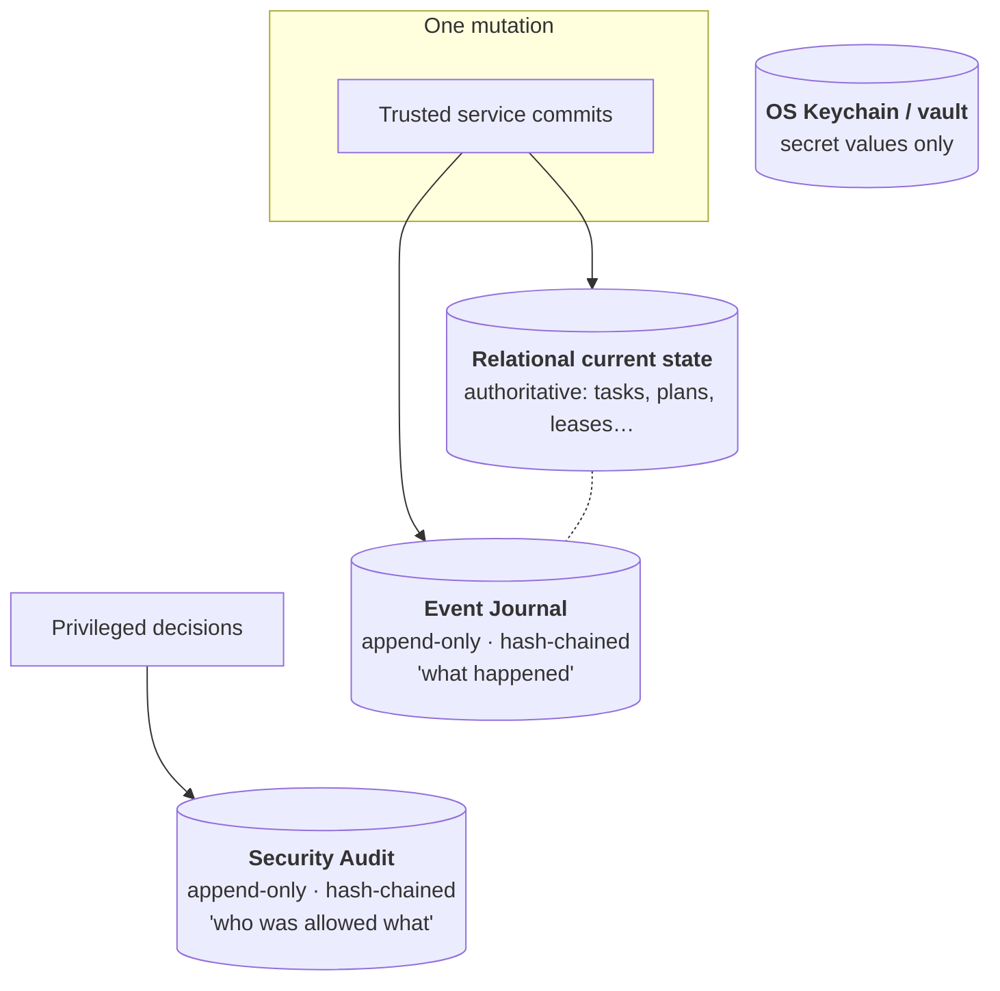

```text
BEGIN
  UPDATE task current state
  INSERT event-journal record
COMMIT          ← state and its evidence land together, or not at all
```

- **Not full Event Sourcing** in v1: normal operation never replays history to rebuild state.
- The journal is **tamper-evident** (SHA-256 hash chain, append-only triggers). It detects row mutation,
  reordering, and tail truncation when the head is preserved — it is not a signature against full host compromise.
- **Operational logs, the Event Journal, and the Security Audit are three separate concerns**, and the audit never
  flows into model context.

### 🔌 IPC handshake

`agentd` is reachable only through a user-private Unix Domain Socket (Named Pipe on Windows) — never localhost
HTTP, WebSocket, or TCP. **Local does not mean trusted.**

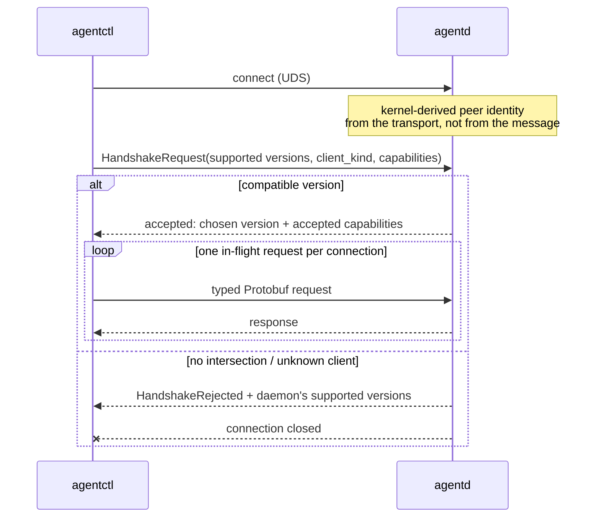

`client_kind` is descriptive metadata — a caller claiming `tauri-host` proves nothing. A negotiated capability is
neither permission nor authentication. Reconnect is a new transport plus a new handshake, never restored socket
state.

### 🔑 Secrets

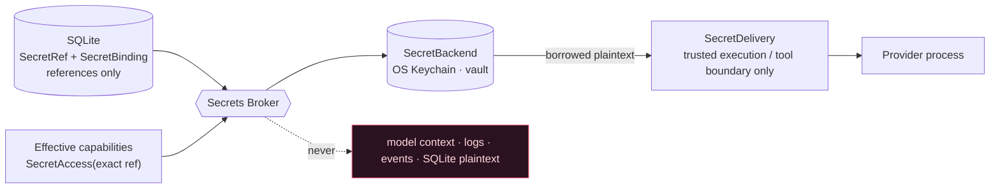

Plaintext is borrowed only through the trusted delivery boundary and never becomes ordinary application state.

---

## ✦ Repository map

```text
runlith/
├── bins/
│   ├── agentd/            daemon: listener + composition root
│   └── agentctl/          CLI: semantic lifecycle commands
├── crates/                domains, services, contracts (34)
│   ├── task · plan · scheduler · policy · evaluation · workspace
│   ├── context-engine · continuity · takeover · repo-finder
│   ├── runner · secrets · security-audit · agent-runtime
│   ├── app-services       trusted mutation + orchestration
│   └── ipc-contracts · ipc-control · ipc-transport
├── adapters/              concrete I/O, one replaceable crate each (12)
│   ├── storage-sqlite · git-cli · provider-claude · finder-local
│   ├── runner-native · runner-macos-seatbelt · effect-capture-local
│   ├── keychain-native · secrets-vault
│   └── fake-agent · fake-planner · fake-evaluator   deterministic test doubles
├── contracts/             JSON schemas for task and event representations
├── docs/architecture/     binding contracts, invariants, ADRs
├── docs/security/         policy, trust boundaries, threat model
├── planning/              roadmap + task queue (versioned scope & acceptance)
└── product/version.toml   canonical product-version identity
```

Go deeper: [`ARCHITECTURE.md`](ARCHITECTURE.md) · [Invariants](docs/architecture/INVARIANTS.md) ·
[ADRs](docs/architecture/adr/INDEX.md) · [IPC](docs/architecture/ipc.md) ·
[Task engine](docs/architecture/task-engine.md) · [Events](docs/architecture/events.md) ·
[Providers](docs/architecture/providers.md)

## ✦ Principles

- **Local-first.** Cloud and telemetry are opt-in only.
- **Provider-neutral core.** No provider-specific type in domain semantics.
- **Context is disposable.** Prompts are derived state, never the system of record.
- **Prompts are not a security boundary.** Policy decides; isolation enforces.
- **Evidence over claims.** Completion requires verification.
- **Fail closed.** Missing enforcement, unknown capability, ambiguous ownership → refuse, don't guess.
- **Honest isolation.** `NativeRunner` is not a sandbox, and Runlith never claims it is.

### Non-goals (v1)

Another multi-terminal GUI · a generic chat app · a single-provider product · microservices for the local
runtime · cloud-required operation · an autonomous CTO · unrestricted host execution.

## ✦ Status & roadmap

Gates advance on **exit criteria, never calendar dates**.

| Gate | Milestone | Status |
|:---:|---|:---:|
| G0 | Architecture freeze | ✅ |
| G1 | Local control channel (handshake, version negotiation, reconnect) | ✅ |
| G2 | Task core — state machine, SQLite, event journal, `agentctl` | ✅ |
| G3 | FakeAgent runtime — task → schedule → submit → verify | ✅ |
| G4 | Workspace / Git — worktrees, branches, diff, cleanup | ✅ |
| G5 | First real provider (Claude) | ✅ |
| G6 | Security — policy, approvals, secret broker, audit, runner isolation | ✅ |
| G7 | Multi-agent DAG + bounded adaptive planning | ✅ |
| G8 | Verification | ✅ |
| G9 | Context engine + continuity | ✅ |
| G10 | Memory engine | ✅ |
| G11 | Background daemon | ✅ |
| G12 | Remote worker | ✅ |
| **G13** | **Cloud / team** | 🚧 *in progress* |
| G14 | Router / usage economics | ⏳ |

The authoritative plan lives in [`planning/roadmap.yaml`](planning/roadmap.yaml).

## ✦ Development

```sh
cargo fmt --all --check
cargo clippy --workspace --all-targets --locked -- -D warnings
cargo test --workspace --locked --no-fail-fast
```

Build `agentd` and `agentctl` **before** running binary-level tests — they locate sibling executables, and a
stale `target/debug/agentd` gives stale results.

CI runs the same three checks on macOS with a pinned Rust `1.95.0`
([workflow](.github/workflows/verification.yml)).

## ✦ Contributing

Contributions are welcome. Open a discussion first for larger changes.

- Read [CONTRIBUTING.md](CONTRIBUTING.md); sign off commits (`git commit -s`).
- Coding agents must follow [AGENT.md](AGENT.md) — the repository's canonical policy.
- Found a vulnerability? **Do not open a public issue.** See [SECURITY.md](SECURITY.md).

## ✦ License

[Apache-2.0](LICENSE) — use it, modify it, ship it, commercially or not. Contributions are accepted under the
same terms (inbound = outbound). See [LICENSING.md](LICENSING.md).

<br>

<div align="center">

<sub>Built so the work outlives the session.</sub>

</div>
