# Runlith desktop

Tauri 2 + React 19 shell over `agentd` (ADR-0007, ADR-PROPOSED frontend stack).
Gate G16 (TASK-0230). Task and project data are read only; the only state it
writes is the overview layout and the cache of live numbers, both in app data.

## What is live and what is demo

| Screen | Source |
| --- | --- |
| Projects, tasks, task state, dependencies | agentd `task_core` (live); dependency ids come with `task-list-pages-v1` pages |
| Attention queue | agentd `human_decision_core` list (live, read only) |
| Connection | live handshake as client kind `tauri-host`, polled every 5 s |
| Plan, Changes, Evidence, History, Map, gate charts | demo, labelled in the UI: agentd has no read contract yet |
| Task Overview: scope and branch timeline | demo (branch TASK-0229), labelled "демо: ветка TASK-0229" |
| Settings: theme, row density, text size, reduced motion | per-viewer `localStorage` key `runlith.settings.v1`, no daemon involved |
| Agent chat | no transcript, message ids or streaming in agentd; sending is disabled with an explanation |
| Overview layout | `dashboard.json` in app data (host, live) |
| Widget from a description | agentd `widget_core` v13, then the claude CLI (live) |
| Stars and open PRs on a widget | host requests to api.github.com (live) |

## Screenshots

Light and dark, 1440 px wide, from the Playwright run against the production
build with labelled demo data (`npm run preview`). Refresh them with
`npm run test:e2e` and copy the files named below from `e2e/screenshots/`
(that folder is git-ignored; these copies are the committed record).

| Screen | Light | Dark |
| --- | --- | --- |
| Overview | 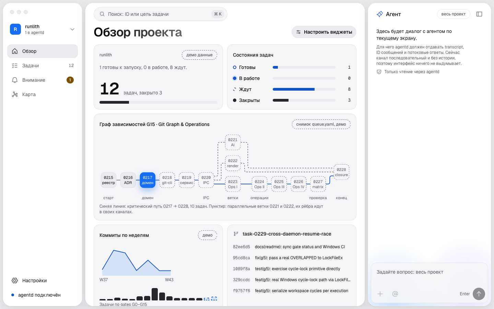 | 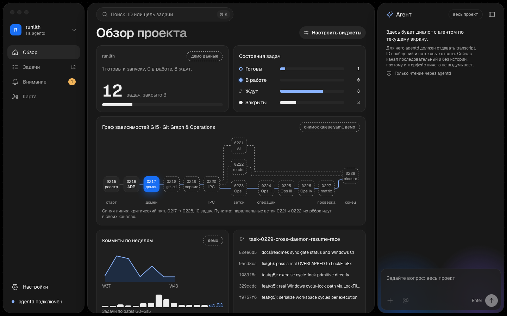 |
| Tasks | 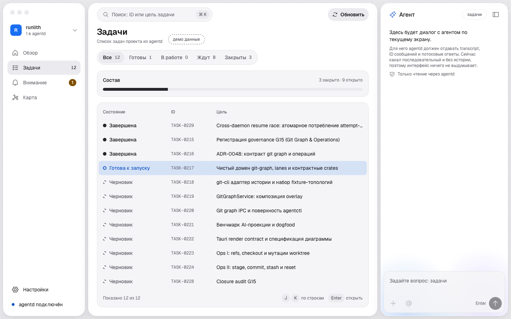 | 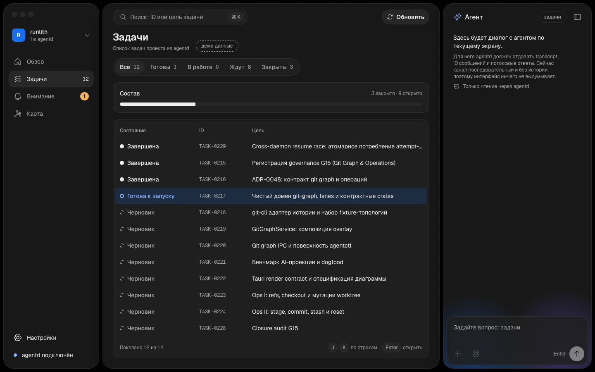 |
| Task Overview | 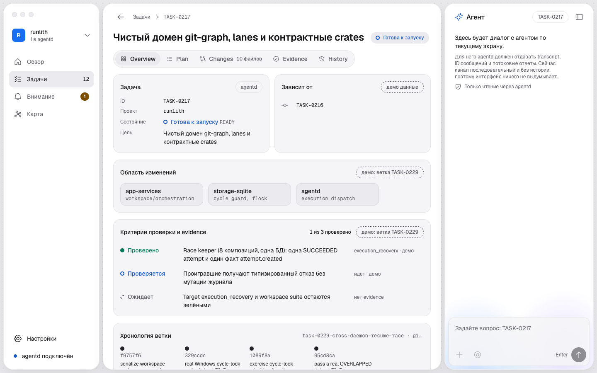 | 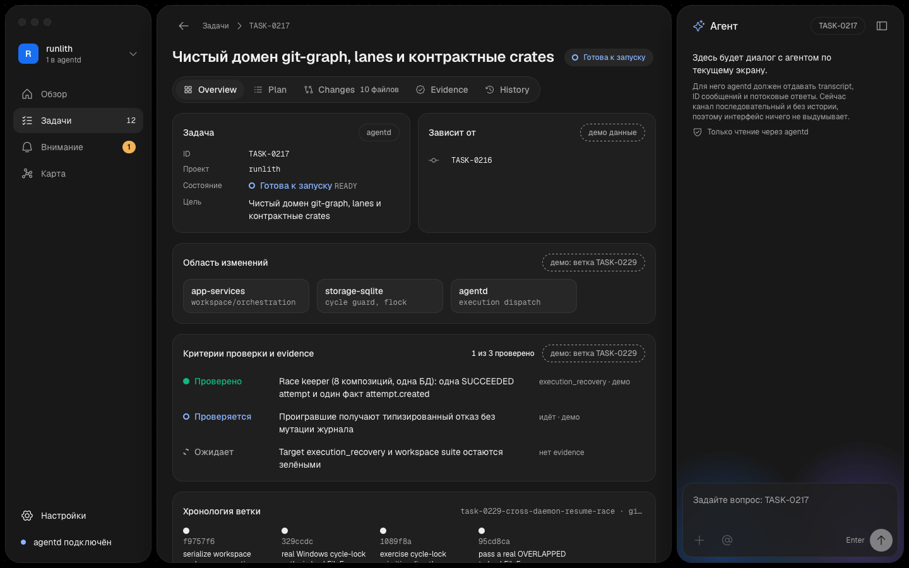 |
| Task Changes | 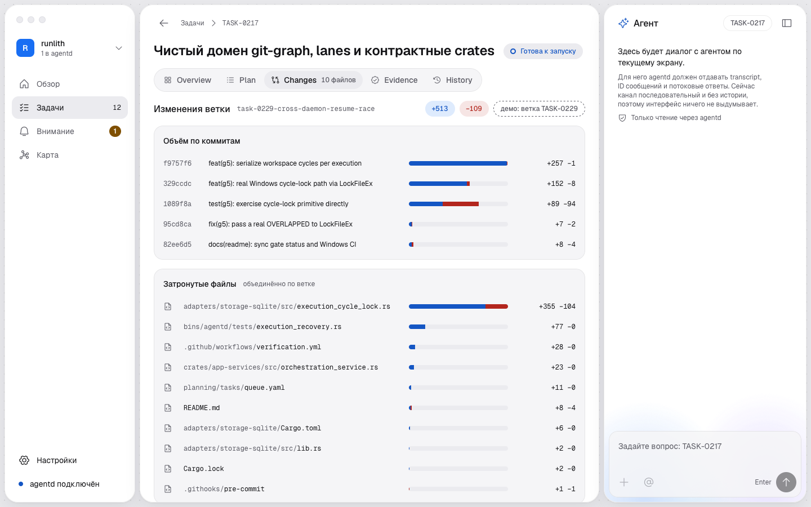 | 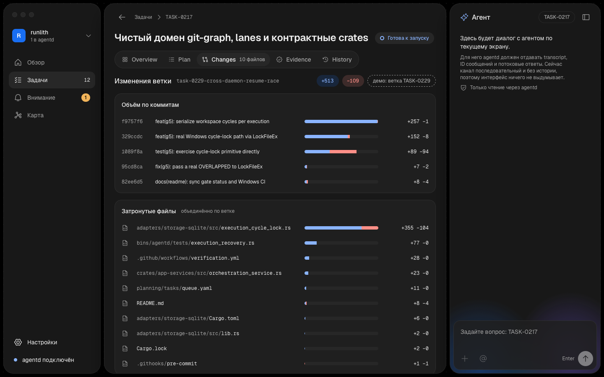 |
| Attention | 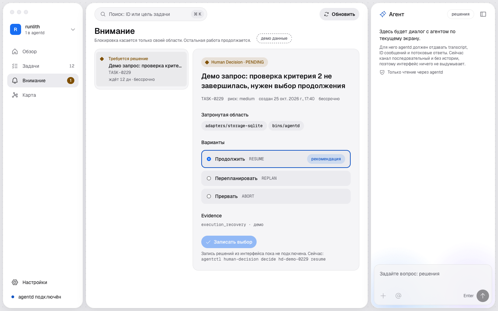 | 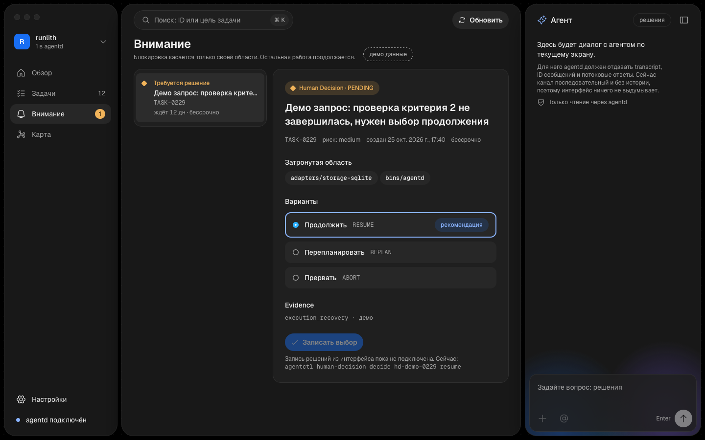 |
| Map | 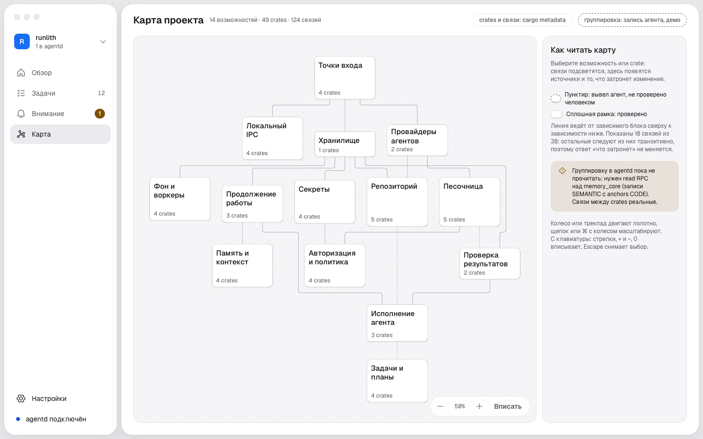 | 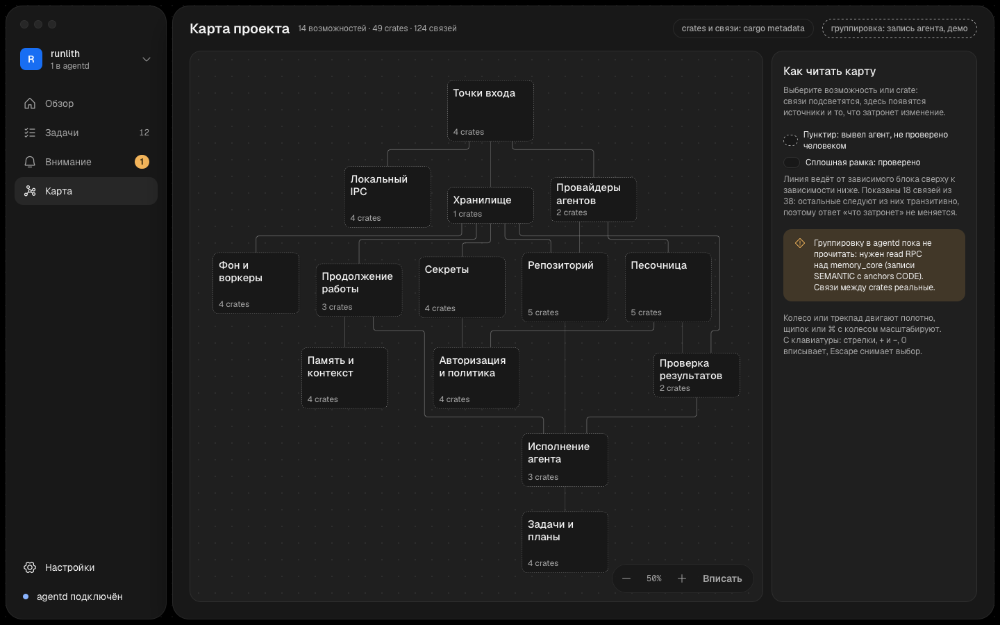 |
| Settings | 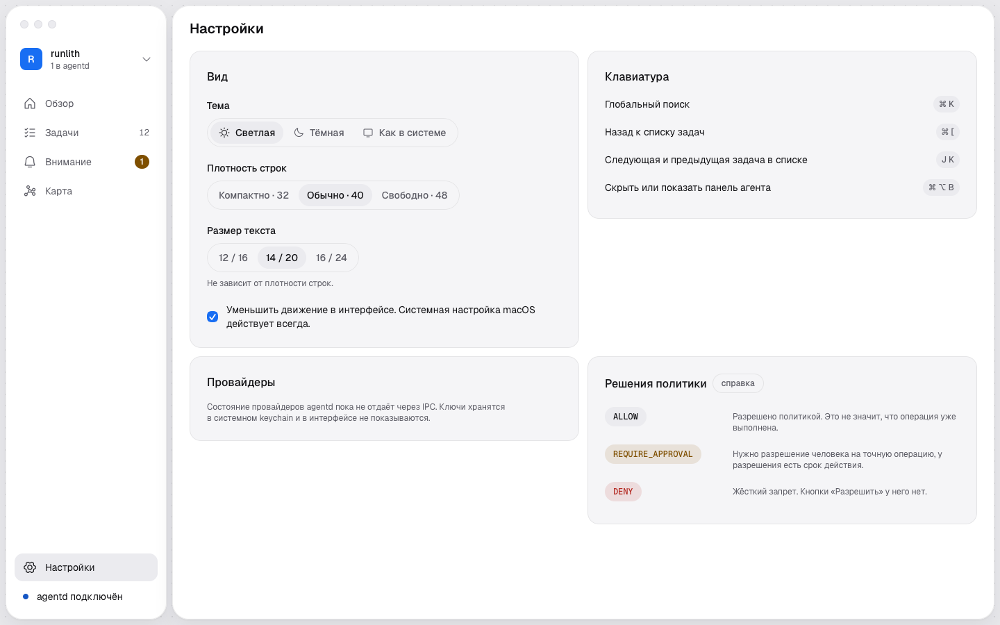 | 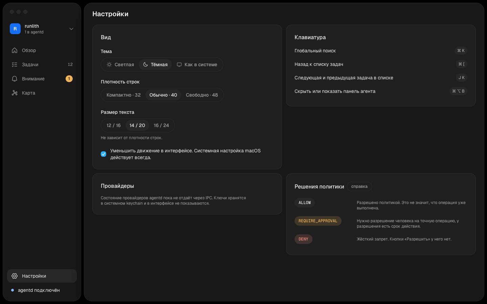 |

## Differences from the design canvas

Checked against the "Runlith Desktop UI" canvas (14 artboards) on 2026-11-07, both
themes. The shell, navigation, task tabs, map, states and both themes match. What
the canvas shows and the app does not yet:

| Screen | Canvas | App | Why |
| --- | --- | --- | --- |
| Overview | "Новая задача" button | "Настроить виджеты" | G16 widgets; no task-create RPC |
| Tasks | Gate column; state "Ждёт зависимости" | "Зависит от" column from agentd (`TaskDto.dependsOn`); "ждёт зависимости" is derived from dependency state, the lifecycle name stays DRAFT/READY | agentd has no per-task gate (it lives in `planning/tasks/queue.yaml`): open part of TASK-0261 |
| Attention | Ratify / Defer options, PENDING → RESOLVED → CONSUMED steps | RESUME / REPLAN / ABORT, no steps, "Записать выбор" disabled | no write RPC for decisions |
| Plan | List / Graph toggle | list only | no plan read contract |
| History | commit timeline sized by changed lines | journal list only | no event journal query |
| Settings | Providers card with "Доступен" status; command palette shortcut | providers stub text; no palette row | providers are not exposed over IPC; no command palette yet |
| Composer | attachment chips with loading, error, too-large states; `@` mentions | files from Changes attach as chips; the + button is disabled | no attachment contract |
| System | tokens and components page | not an app screen | design reference only |

Not compared: Connection and States artboards beyond the three states the e2e
suite renders (unavailable, empty, loading); the "stale snapshot" and
"capability not supported" states are not implemented.

The webview never runs shell, git, SQLite or file access. Every command is
declared in `src-tauri/build.rs` and granted in `src-tauri/capabilities/default.json`.
The host never starts agentd; a missing daemon shows as "agentd не запущен".

## Overview widgets

A description goes to agentd and through it to the claude CLI, with no tools,
no files and an empty working directory. The answer is parsed by
`crates/widget-spec`, the only definition of the format; `src/lib/bindings/` is
generated from it. A widget is data: it holds no code, HTML or URL. v1 has two
sources, `github.repo.stars` and `github.repo.open_prs`. Anything else is refused.

- **Layout.** `dashboard.json` is versioned and written atomically. A file that
  does not parse is kept as `dashboard.corrupt-<ms>.json`, and the stock layout
  is shown with a notice.
- **GitHub.** Only the host calls GitHub, only api.github.com, without a token,
  so the limit is 60 requests an hour per IP. It sends `If-None-Match`, honours
  `Retry-After` and the rate-limit headers, asks at most once per interval per
  source, and keeps the last value in `metric-cache.json`. Open PRs come from
  `/pulls?state=open&per_page=1` and its `Link` header, because
  `open_issues_count` also counts issues.
- **Provider access.** Under Seatbelt the provider runs in brokered mode
  (ADR-0039), so a real draft needs an unlocked vault holding a token:
  `agentctl vault init`, `claude setup-token`, `agentctl vault store`.

## Commands

```bash
npm install
npm run bindings        # cargo test: host unit tests + regenerates src/lib/bindings/*.ts (ts-rs)
npm run dev             # browser preview with labelled demo data
npm run tauri dev       # desktop app against the running agentd
npm run tauri build     # src-tauri/target/release/bundle/macos/Runlith.app
npx playwright install webkit   # once per machine; the e2e suite runs on WebKit
npm run test:e2e        # needs `npm run build` first. WebKit, 50 tests: screens x themes x sizes, axe WCAG 2.1 AA, graph geometry, states, keyboard, frames, widgets
npm run maps            # regenerate src/lib/map/maps.generated.json (cargo metadata + queue.yaml + ELK layout)
npm run test:data       # map data equals cargo metadata and queue.yaml; edges keep 12 px from nodes; decision age and expiry text; widget failure text and repo rule
```

Project map (`Карта`): a pan and zoom canvas of capabilities the agent recorded
(`src/lib/map/capabilities.ts`, shaped like memory_core SEMANTIC records) over
real crates and dependencies. Layout is computed at build time by elkjs, so the
library is not in the app bundle. `stitch/` holds DESIGN.md and a Stitch prompt.

## Known limits

- The frame-gap e2e (`motion: a screen change adds no long frames`) measures real
  vsync timing. On the shared macOS CI runner it failed on every attempt (busy max
  48-70 ms against idle 19-28 ms), so it is skipped when `CI` is set and runs locally
  only. It was never green on CI.

On this Mac cargo needs `DEVELOPER_DIR=/Library/Developer/CommandLineTools`.
Browser preview can force states: `?demo=empty`, `?demo=unavailable`, `?demo=loading`,
and for widgets `draft-slow`, `draft-missing`, `draft-incompatible`, `draft-auth`, `draft-timeout`,
`draft-bad`, `draft-outage`, `draft-failed`, `metric-offline`, `metric-limited`, `metric-notfound`,
`dashboard-corrupt`, `dashboard-save-fails`.

## Design system

`src/styles/runlith.css` (an index importing `runlith-base.css` and
`runlith-features.css`, split for the repository's file-size gate; import order
is cascade order) is the single source for the app and the
"Runlith Desktop UI" design canvas (uploaded there as an asset). Values follow
elayadesign/ai-design-skills `landing-page-design` Part B: Geist, Tailwind type
scale, the spacing table, Tailwind radii, `cubic-bezier(0.22, 1, 0.36, 1)`.
Deliberate deviation: the dot texture and the agent aurora glow come from the
owner's reference. Native macOS vibrancy (`windowEffects: sidebar`) shows
between the tiles.

## Layout

`src-tauri/` is its own Cargo workspace so Tauri's dependency tree stays out of
the core workspace and its `Cargo.lock`.
